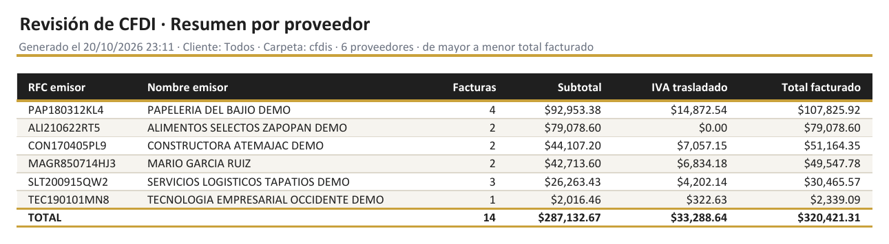
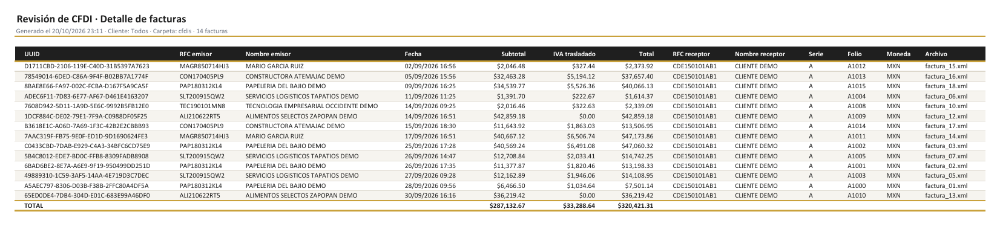
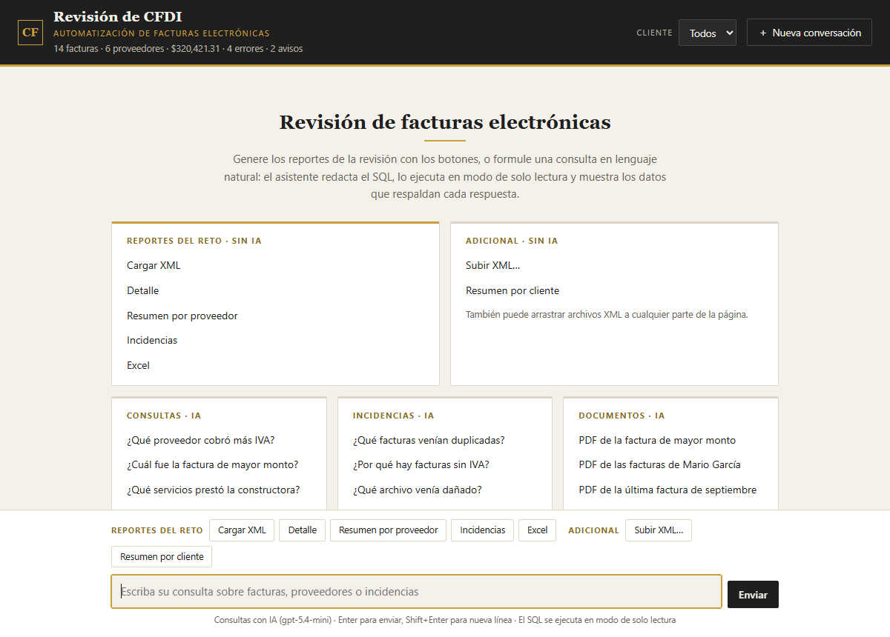
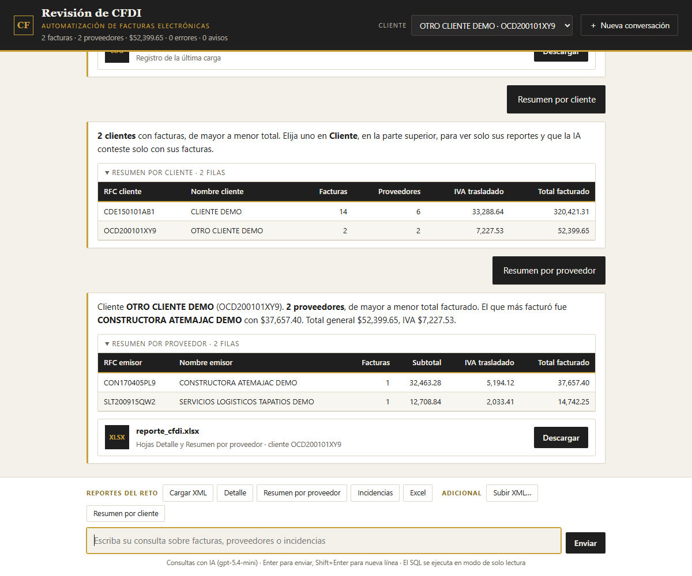

# Automatización de revisión de CFDI

Lee una carpeta de facturas electrónicas (XML de CFDI 3.3 y 4.0), valida cada archivo sin detenerse ante
errores, guarda las facturas en una base SQLite y genera un Excel de revisión y un registro de incidencias.
Como extra, incluye un asistente en el navegador que hace lo mismo con botones, separa por cliente, recibe XML
arrastrados, responde preguntas en lenguaje natural mostrando el SQL que ejecuta y genera el PDF de cada
factura.

| | Qué hace | Cómo se corre |
|---|---|---|
| **El reto** | Exactamente lo que pide la prueba: lee `cfdis/`, extrae los datos, detecta duplicados y archivos dañados, y genera el Excel y el log. No usa IA. | `python reto.py` |
| **El extra (bot)** | Chat local con los reportes del reto (sin IA) y, además: filtro y resumen por cliente, subida de XML, consultas con IA y PDF de las facturas. | `python bot.py` |

## Inicio rápido

```bash
pip install -r requirements.txt
python reto.py      # -> salida/reporte_cfdi.xlsx y salida/incidencias.log
python bot.py       # -> http://localhost:5000  (opcional)
```

Los entregables ya generados están en [`salida/reporte_cfdi.xlsx`](salida/reporte_cfdi.xlsx) y
[`salida/incidencias.log`](salida/incidencias.log).

## Contenido

1. [Cómo se cumple cada punto del reto](#cómo-se-cumple-cada-punto-del-reto)
2. [Resultado con los archivos de la prueba](#resultado-con-los-archivos-de-la-prueba)
3. [Instalación](#instalación)
4. [El reto: `reto.py`](#el-reto-retopy)
5. [El extra: el bot](#el-extra-el-bot)
6. [Evaluaciones de la IA](#evaluaciones-de-la-ia)
7. [Cómo funciona](#cómo-funciona)
8. [Validaciones e incidencias](#validaciones-e-incidencias)
9. [Decisiones técnicas](#decisiones-técnicas)
10. [Seguridad y privacidad](#seguridad-y-privacidad)
11. [Pruebas](#pruebas)
12. [Estructura del proyecto](#estructura-del-proyecto)
13. [Limitaciones conocidas](#limitaciones-conocidas)
14. [Camino a producción](#camino-a-producción)

---

## Cómo se cumple cada punto del reto

| # | Lo que pide la prueba | Dónde se resuelve |
|---|---|---|
| 1 | Leer la carpeta `cfdis` | `python reto.py` lee todos los `.xml` de `cfdis/` (o de la carpeta que se le indique), en orden de nombre. |
| 2 | Extraer UUID, RFC y nombre del emisor, fecha, subtotal, IVA trasladado y total | `revision/lectura.py` → `leer_cfdi()`. El IVA es la suma de los traslados con `Impuesto="002"`. |
| 3 | Detectar duplicados (mismo UUID) y archivos dañados o que no sean CFDI, sin detenerse | Cada archivo se procesa en su propio `try`; los problemas se registran como incidencias y el lote continúa (`revision/base.py` → `cargar()`). |
| 4 | Excel con hojas "Detalle" y "Resumen por proveedor" (total e IVA por RFC emisor, de mayor a menor) | `revision/reportes.py` → `libro()`. Una fila por factura en "Detalle"; "Resumen por proveedor" ordenado por total facturado, con fila de totales. |
| 5 | Registro (log) de incidencias | `salida/incidencias.log`, con fecha, nivel (ERROR / AVISO), archivo, tipo y detalle. |

## Resultado con los archivos de la prueba

El paquete trae **18 XML**, no 20: faltan `factura_08.xml` y `factura_09.xml`. Se cargaron **14 facturas**
de **6 proveedores**, por **$320,421.31**, con **$33,288.64** de IVA trasladado.

| Archivo | Nivel | Incidencia |
|---|---|---|
| `factura_04.xml` | ERROR | Duplicada: mismo UUID que `factura_03.xml` |
| `factura_11.xml` | ERROR | Duplicada: mismo UUID que `factura_10.xml` |
| `factura_19.xml` | ERROR | XML dañado: el archivo está truncado |
| `factura_20.xml` | ERROR | No es CFDI: es un XML de tipo `<Pedido>` |
| `factura_12.xml`, `factura_13.xml` | AVISO | IVA en cero: tasa 0% (alimentos). Se cargan, pero se señalan |

Resumen por proveedor:



## Instalación

Requiere **Python 3.10 o más reciente** (desarrollado y probado con 3.12).

```bash
python -m venv .venv
.venv\Scripts\activate            # Windows   ·   en Linux/macOS: source .venv/bin/activate
pip install -r requirements.txt
```

| Dependencia | Para qué |
|---|---|
| `openpyxl` | Escribir el Excel (reto) |
| `defusedxml` | Leer los XML de forma segura (reto y bot) |
| `flask` | Servidor del bot |
| `reportlab` | PDF de las facturas (bot) |
| `openai`, `python-dotenv` | Consultas con IA (bot) |
| `pytest` | Pruebas |

### Configuración (solo para las consultas con IA)

Copie `.env.example` como `.env` y llene:

| Variable | Obligatoria | Valor por omisión | Descripción |
|---|---|---|---|
| `OPENAI_API_KEY` | Para las consultas con IA | — | Llave de [platform.openai.com](https://platform.openai.com/api-keys) |
| `MODELO_OPENAI` | No | `gpt-5.4-mini` | Modelo a usar |
| `PUERTO_WEB` | No | `5000` | Puerto del bot |

El reto y los botones del bot funcionan **sin llave y sin internet**.

## El reto: `reto.py`

```bash
python reto.py                  # lee cfdis/
python reto.py OTRA_CARPETA     # lee otra carpeta
```

Deja en `salida/`:

| Archivo | Contenido |
|---|---|
| `reporte_cfdi.xlsx` | El Excel de revisión (ver abajo). Solo incluye las facturas de la carpeta leída. |
| `incidencias.log` | Registro de la corrida: archivos con error y avisos. Se reescribe en cada corrida. |
| `facturas.db` | Base SQLite con facturas, conceptos e incidencias. Es la que usa el bot. |

### El Excel

- **Detalle:** una fila por factura con UUID, RFC y nombre del emisor, fecha, subtotal, IVA trasladado y
  total, más RFC y nombre del receptor, serie, folio, moneda y archivo de origen.
- **Resumen por proveedor:** por cada RFC emisor, número de facturas, subtotal, IVA trasladado y total
  facturado, de mayor a menor.

Formato corporativo (carbón y dorado): título con fecha de generación, encabezados oscuros, filas alternadas,
importes en `$#,##0.00`, fechas `dd/mm/aaaa hh:mm`, filtros, encabezado fijo, y fila **TOTAL** con fórmulas
`=SUM()` para que siga cuadrando si alguien edita el archivo. Listo para imprimir: horizontal, ajustado al
ancho, con encabezado repetido y "Página X de N".



### El log

```
2026-10-20 23:11:56 | INFO    | Carpeta cfdis: 18 archivos XML
2026-10-20 23:11:56 | ERROR   | factura_04.xml | Duplicada | El UUID C0433CBD-7DAB-E929-C4A3-34BFC6CD75E9 ya se cargó desde factura_03.xml
2026-10-20 23:11:56 | ERROR   | factura_11.xml | Duplicada | El UUID 7608D942-5D11-1A9D-5E6C-9992B5FB12E0 ya se cargó desde factura_10.xml
2026-10-20 23:11:56 | AVISO   | factura_12.xml | IVA en cero | IVA a tasa 0% o exento
2026-10-20 23:11:56 | AVISO   | factura_13.xml | IVA en cero | IVA a tasa 0% o exento
2026-10-20 23:11:56 | ERROR   | factura_19.xml | XML dañado | El XML está mal formado o incompleto (unclosed token: line 6, column 4)
2026-10-20 23:11:56 | ERROR   | factura_20.xml | No es CFDI | El elemento raíz es <Pedido>; se esperaba cfdi:Comprobante 3.3 o 4.0
2026-10-20 23:11:56 | INFO    | Cargadas: 14 | Con error (no cargadas): 4 | Avisos: 2 | Facturas en la base: 14
```

## El extra: el bot

```bash
python bot.py        # carga cfdis/ y abre http://localhost:5000
```



### Reportes del reto, sin IA

Botones siempre visibles: **Cargar XML**, **Detalle**, **Resumen por proveedor**, **Incidencias** y
**Excel**. Responden directo de la base con tabla y archivo descargable; funcionan aunque no haya llave de
OpenAI ni internet.

### Separación por cliente

KM&G revisa las facturas *de sus clientes*, así que el **receptor** de cada CFDI es el cliente. El selector
**Cliente** del encabezado limita a ese cliente los reportes, el Excel descargado y las consultas con IA;
**Resumen por cliente** compara a todos.



### Subir XML

Se arrastran a cualquier parte de la página o se eligen con **Subir XML…**. Cada subida se guarda en
`salida/subidos/<fecha y hora>/` junto con su propio log, y se carga con las mismas validaciones del reto: un
UUID que ya estaba en la base sale como duplicado.

### Consultas con IA

Preguntas como "¿qué proveedor cobró más IVA?" o "¿qué servicios prestó la constructora?". El modelo escribe
el SQL, el programa lo valida y lo ejecuta en solo lectura, y la respuesta muestra **el SQL y las filas que
la respaldan**. Recuerda los últimos 6 intercambios, así que entiende preguntas de seguimiento ("¿y su
PDF?"). Responde de usted, con tono profesional.

### PDF de las facturas

"PDF de la factura de mayor monto" adjunta la representación impresa (con QR de verificación del SAT) para
verla en la página o descargarla.

### Para la demostración

Todos los XML de la prueba son del mismo receptor. Para probar la separación por cliente y la subida,
`ejemplos/otro_cliente/` trae tres XML ficticios armados a partir de ellos: dos facturas para
"OTRO CLIENTE DEMO" y un reenvío de `factura_05.xml`, que debe salir como **duplicado**. Basta con
arrastrarlos al chat.

## Evaluaciones de la IA

¿Cómo saber que la IA contesta bien? Con preguntas cuya respuesta ya se conoce:

```bash
python evals/correr.py                    # las 17 preguntas
python evals/correr.py --caso duplicadas  # solo una
python evals/correr.py --veces 3          # cada una 3 veces: el modelo no siempre contesta igual
```

`evals/casos.json` tiene 17 preguntas cuyas respuestas se calcularon con SQL: totales, el proveedor con más
IVA, la persona física, conteos, los archivos duplicados, el archivo dañado, qué **no** debe ver con un
cliente elegido, el PDF correcto y una pregunta fuera de tema. El script arma una base temporal con
`cfdis/` y `ejemplos/otro_cliente/` (no toca `salida/`), hace cada pregunta al modelo real y revisa la
respuesta sin importar acentos, mayúsculas, `$` ni comas. El detalle (respuesta, SQL y fallas) se guarda en
`evals/resultados/`. Requiere `OPENAI_API_KEY`.

**Lo que encontró.** La primera corrida dio **14/17**, y las tres fallas eran reales:

| Pregunta | Qué respondió | Causa | Corrección |
|---|---|---|---|
| ¿Cuántas facturas mandó Servicios Logísticos Tapatíos? | "**0** facturas" (son 3) | Buscó el nombre con acentos y en la base viene sin ellos | Función `norm()` en SQL que ignora acentos y mayúsculas, y regla de usarla siempre |
| ¿Cuánto le facturaron a cada cliente? | Solo los RFC, sin nombres | Faltaba la regla | "Al mencionar un proveedor o cliente, da su nombre y su RFC" |
| ¿Hubo algún archivo que no fuera factura? | Contó los duplicados como "no facturas" | Ambigüedad | Regla que distingue duplicadas de archivos que no son CFDI |

Después de las correcciones, los tres casos pasaron.

## Cómo funciona

```
              cfdis/*.xml                     XML subidos desde el bot
                   │                                     │
                   ▼                                     ▼
     revision/lectura.py  leer_cfdi(): lee y valida cada XML ──► avisos
                   │
                   ▼
     revision/base.py     cargar(): duplicados, incidencias, log ──► salida/incidencias.log
                   │
                   ▼
            SQLite  salida/facturas.db  (facturas · conceptos · incidencias)
                   │
        ┌──────────┴──────────────────────────────┐
        ▼                                         ▼
 revision/reportes.py                      asistente/ (bot)
 detalle · resumen · Excel                 web.py       botones del reto, cliente, subida
        │                                  preguntas.py consultas con IA (SQL de solo lectura)
        ▼                                  pdf.py       PDF de cada factura
 salida/reporte_cfdi.xlsx
```

### Flujo de una carga

1. Se listan los `.xml` de la carpeta, en orden de nombre.
2. Para cada archivo, se borra lo que se hubiera cargado antes desde él (facturas, conceptos e
   incidencias). Por eso correr la carga dos veces da el mismo resultado.
3. `leer_cfdi()` lee el XML con `defusedxml`. Si no se puede cargar, lanza `Invalido` con el tipo de error.
4. Si el UUID ya está en la base desde otro archivo, se registra como **Duplicada** y no se carga.
5. Si es válida, se guardan la factura y sus conceptos, y sus avisos se registran como incidencias.
6. Cada incidencia se escribe en la tabla `incidencias` y en el log.

### Modelo de datos

| Tabla | Contenido | Columnas principales |
|---|---|---|
| `facturas` | Una fila por UUID | `uuid` (llave), `fecha`, `tipo`, `moneda`, `subtotal`, `descuento`, `iva`, `retenciones`, `total`, `emisor_rfc`, `emisor_nombre`, `receptor_rfc`, `receptor_nombre`, `serie`, `folio`, `archivo` |
| `conceptos` | Las partidas de cada factura | `uuid`, `clave_prod`, `descripcion`, `cantidad`, `unidad`, `valor_unitario`, `importe` |
| `incidencias` | Errores y avisos de las cargas | `archivo`, `nivel`, `tipo`, `detalle`, `uuid` |

Índices por RFC emisor, RFC receptor y UUID de los conceptos.

### Rutas del bot

| Método | Ruta | Qué hace |
|---|---|---|
| GET | `/` | La página del chat |
| GET | `/estado?cliente=` | Cifras del encabezado y lista de clientes |
| POST | `/reto/<acción>` | Reportes sin IA: `cargar`, `detalle`, `resumen`, `clientes`, `incidencias`, `excel` |
| POST | `/subir` | Recibe XML (multipart, con cabecera `X-Bot: 1`) y los carga |
| POST | `/preguntar` | Consulta con IA |
| POST | `/reiniciar` | Empieza una conversación nueva |
| GET | `/pdf/<uuid>` | PDF de una factura |
| GET | `/reporte_cfdi.xlsx?cliente=` | Excel de revisión (de todos o de un cliente) |
| GET | `/incidencias.log` | Log de la última carga de `cfdis/` |
| GET | `/subidos/<subida>/incidencias.log` | Log de una subida |

## Validaciones e incidencias

| Nivel | Tipo | Cuándo |
|---|---|---|
| ERROR | XML dañado | El XML está mal formado o incompleto |
| ERROR | XML no permitido | El XML trae construcciones inseguras (entidades, referencias externas) |
| ERROR | No es CFDI | La raíz no es `cfdi:Comprobante` con el namespace del SAT 3.3 o 4.0 |
| ERROR | Sin timbre | No tiene `TimbreFiscalDigital` con UUID |
| ERROR | Datos incompletos | Falta o no es válido: Fecha, SubTotal, Total o RFC del emisor |
| ERROR | Duplicada | El UUID ya se cargó desde otro archivo |
| ERROR | Error inesperado | Cualquier otro problema con un archivo; el lote continúa |
| AVISO | RFC inválido | El RFC del emisor no tiene el formato del SAT |
| AVISO | RFC receptor inválido | El RFC del receptor falta o no tiene el formato del SAT |
| AVISO | Totales no cuadran | `SubTotal − Descuento + Traslados − Retenciones (+ impuestos locales) ≠ Total`, con tolerancia de $0.01 |
| AVISO | IVA en cero | Factura de ingreso sin IVA: indica si es tasa 0% / exento o si no traslada IVA |
| AVISO | No es de ingreso | Nota de crédito, pago, etc.: aparece en el detalle pero no suma en el resumen |
| AVISO | Moneda extranjera | La moneda no es MXN |

**ERROR** = el archivo no se cargó. **AVISO** = se cargó, pero conviene revisarlo.

## Decisiones técnicas

**Un archivo malo no detiene el lote.** Cada XML se procesa dentro de su propio `try`; el error se registra
y se sigue con el siguiente.

**Duplicados.** Se conserva la primera copia (por orden de nombre de archivo) y las demás se reportan; así
un duplicado no infla el total del proveedor. "Detalle" tiene una fila por UUID.

**IVA trasladado.** Se suman solo los traslados con `Impuesto="002"` del nodo de impuestos del comprobante,
no `TotalImpuestosTrasladados`, que también incluye IEPS.

**Importes con `Decimal`.** Las validaciones se hacen con `Decimal` para no arrastrar errores de redondeo de
`float`. Ejemplo real de `factura_02.xml`: en `float`, `11377.87 + 1820.46` da `13198.330000000002`, no
`13198.33`.

**Resumen por RFC, no por nombre.** El nombre de un proveedor puede venir escrito distinto en cada factura;
el RFC no. Solo se suman facturas de ingreso (`tipo='I'`).

**SQLite como base.** No requiere servidor, permite consultar el histórico y acumular cargas de varios
meses. La carga es idempotente: cada archivo reemplaza lo que se haya cargado antes desde él.

**Reto y bot separados.** `reto.py` hace solo lo que pide la prueba y no depende de la IA, de Flask ni de
reportlab. El bot reutiliza el mismo código (`revision/`), así que el Excel y las cifras son idénticos por
cualquiera de los dos caminos. El Excel de `reto.py` incluye solo la carpeta leída, aunque la base tenga
además lo subido desde el bot.

**La IA no extrae datos.** Leer un XML es exacto con código; un modelo sería más lento, más caro y menos
confiable. La IA se usa donde aporta: consultas libres sobre datos ya validados. Tiene tres herramientas:
`consultar` (SQL), `enviar_pdf` y `enviar_excel`; las dos últimas solo adjuntan archivos que genera el
programa.

**La IA demuestra lo que dice.** Cada respuesta muestra el SQL ejecutado y sus filas, para que el usuario
pueda auditarla. Si una consulta falla, el error regresa al modelo para que la corrija (máximo 5 vueltas
por pregunta).

**Formato corporativo.** El Excel y el bot comparten la misma paleta (carbón y dorado) y el mismo estilo de
tablas, para que la pantalla y el reporte se vean como una sola herramienta.

## Seguridad y privacidad

**SQL de la IA en solo lectura.** Se acepta una sola sentencia `SELECT`/`WITH`, que se ejecuta en una
conexión de **solo lectura** (`mode=ro`), con límite de 10 segundos y 50 filas. Aunque el modelo intentara
un `DELETE` o un `DROP`, la base no lo permitiría.

**Aislamiento por cliente.** Con un cliente elegido, las consultas corren sobre vistas temporales que solo
tienen sus facturas, y el **autorizador de SQLite** prohíbe leer las tablas originales (`main.facturas`).
Aunque el modelo "olvide" filtrar o lo intente a propósito, no puede ver datos de otro cliente. El PDF
tampoco se entrega si la factura es de otro cliente. El RFC elegido se valida antes de usarse.

**Qué se envía a OpenAI.** Solo el esquema de la base, la pregunta y los resultados de las consultas; nunca
los XML completos. La base guarda rutas relativas al proyecto (`cfdis/factura_01.xml`), así que tampoco
viajan rutas personales del equipo.

**XML subidos.** Se leen con `defusedxml`, que rechaza XML maliciosos (entidades que se expanden sin fin,
referencias a archivos externos). El nombre del archivo se limpia para que no pueda escribir fuera de su
carpeta, hay un límite de 20 MB por subida, y la subida exige una cabecera propia que el navegador no deja
mandar desde otra página sin permiso: ningún sitio ajeno puede subir archivos al bot.

**Servidor local.** El bot solo escucha en `127.0.0.1` (accesible únicamente desde la misma computadora), y
las peticiones que modifican algo exigen JSON, que otra página no puede mandar sin permiso.

**Secretos fuera del repositorio.** `.env`, la base, los PDF generados, las subidas y las instrucciones de
la prueba están en `.gitignore`.

## Pruebas

```bash
python -m pytest
```

38 pruebas, en tres archivos. Las del bot imitan a OpenAI, así que no gastan llamadas ni necesitan llave.

| Archivo | Qué cubre |
|---|---|
| `tests/test_reto.py` | Extracción de campos, XML dañado y no CFDI, XML malicioso, carga sin detenerse, duplicados, carga repetible, orden del resumen, reportes por cliente, Excel y log de `reto.py`, Excel solo con su carpeta, carpeta inexistente |
| `tests/test_bot.py` | PDF, SQL de solo lectura (rechazo de `DELETE`, `DROP`, `PRAGMA`, `ATTACH`), conexión de solo lectura, búsqueda sin acentos, consultas con IA y corrección de errores, historial de conversación, adjuntos, botones del reto sin llave, aislamiento por cliente (incluso pidiendo `main.facturas`), filtro por cliente en la web, subida de XML, rechazo de subidas ajenas y de nombres peligrosos, log propio de cada subida |
| `tests/test_evals.py` | El revisor de las evaluaciones y que las cifras esperadas coincidan con los datos |

## Estructura del proyecto

```
Automatizacion_facturas/
├── reto.py                  EL RETO: genera el Excel y el log
├── bot.py                   EL EXTRA: abre el chat
├── revision/                código del reto
│   ├── config.py            rutas (cfdis/, salida/, la base)
│   ├── lectura.py           lectura y validación de un XML de CFDI
│   ├── base.py              base SQLite, carga de una carpeta y log de incidencias
│   └── reportes.py          detalle, resúmenes, incidencias y el Excel con formato corporativo
├── asistente/               código del bot (usa revision/)
│   ├── web.py               servidor (Flask): reportes del reto, cliente, subida, rutas
│   ├── preguntas.py         consultas con IA: instrucciones, herramientas y SQL de solo lectura
│   ├── pdf.py               representación impresa del CFDI
│   └── plantillas/chat.html la página del chat
├── evals/                   evaluaciones de la IA: casos.json, correr.py y resultados/
├── tests/                   test_reto.py, test_bot.py, test_evals.py y conftest.py
├── cfdis/                   XML de la prueba
├── ejemplos/otro_cliente/   XML ficticios de un segundo cliente, para la demostración
├── salida/                  reporte_cfdi.xlsx e incidencias.log (entregables); facturas.db, pdf/, subidos/
├── docs/img/                capturas de este README
├── requirements.txt
├── .env.example
└── pytest.ini
```

## Limitaciones conocidas

- **No se verifica la validez fiscal.** No se valida el XML contra el XSD del SAT, ni el sello digital, ni
  la vigencia del UUID ante el SAT. Con los XML ficticios de la prueba, esa consulta respondería "no
  encontrado" para todos.
- **Moneda.** Las facturas en otra moneda se cargan y se señalan con un aviso, pero sus importes no se
  convierten a pesos.
- **El PDF es una representación impresa** generada desde el XML; no sustituye al XML timbrado.
- **El bot es local y de un solo usuario:** una sola conversación, sin usuarios ni permisos.
- **La IA puede equivocarse.** Por eso cada respuesta muestra su SQL y sus filas, y las evaluaciones miden
  su precisión. Los reportes del reto no dependen de ella.

## Camino a producción

- **Validación fiscal:** XSD del SAT, sello digital y consulta de vigencia del UUID, con caché.
- **Usuarios y permisos por cliente,** reutilizando el aislamiento que ya existe para la IA.
- **Base en servidor** (PostgreSQL) y carga en segundo plano para volúmenes grandes.
- **Recepción automática** de XML (buzón de correo o carpeta compartida) en lugar de cargas manuales.
- **Evaluaciones en integración continua,** para detectar si un cambio de modelo o de instrucciones empeora
  las respuestas.
- **Clasificación del gasto** por categoría a partir de la descripción de los conceptos.
